<p align="center">
  <picture>
    <source media="(prefers-color-scheme: dark)" srcset="docs/brand/bense-logo-dark.svg">
    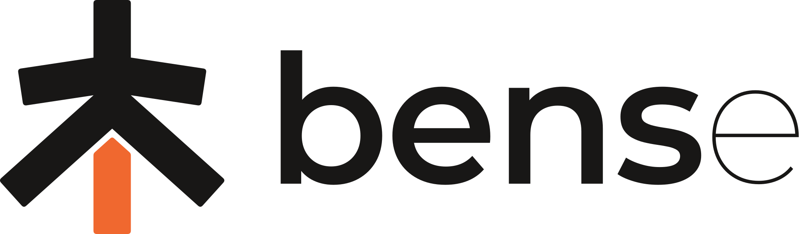
  </picture>
</p>

# Bense (本色): see what a box of hair dye will really do

**One selfie. Your real hair level. The box's honest result.**

Every hair-colour try-on paints the colour from the box onto your photo. But box dye is not paint: it is see-through, and what you get depends on the hair you already have. Bense measures your hair first, works out what the box can really do to it, and shows both on your own photo: what the box promises, and what you will probably get.

Built for the Perfect Corp **YouCam API hackathon, edition 2** (submissions close November 2, 2026). The name is Mandarin: 本色, *běnsè*, "your own true colour".

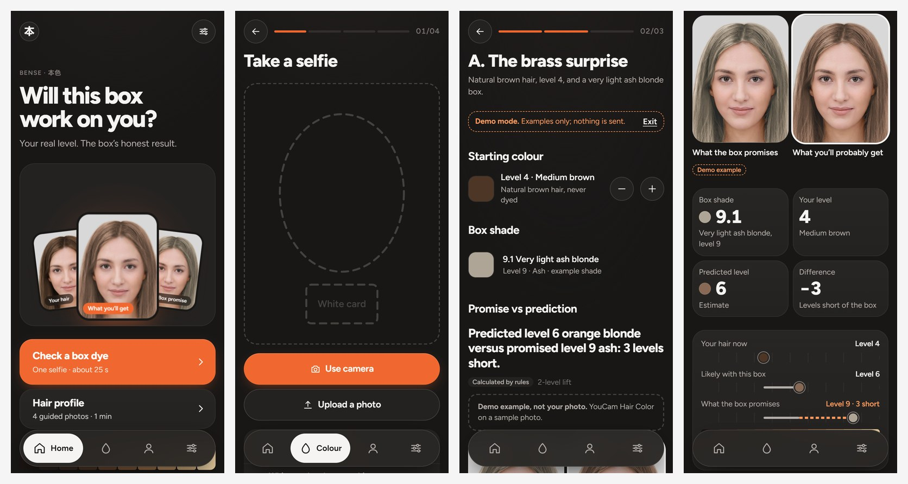

---

## Contents

1. [The problem, in numbers](#1-the-problem-in-numbers)
2. [What Bense does](#2-what-bense-does)
3. [How the prediction works](#3-how-the-prediction-works)
4. [Measuring your hair level](#4-measuring-your-hair-level)
5. [Making the dye look like real hair](#5-making-the-dye-look-like-real-hair)
6. [The YouCam APIs we use](#6-the-youcam-apis-we-use)
7. [Where each part runs](#7-where-each-part-runs)
8. [What we tested live, and what we found](#8-what-we-tested-live-and-what-we-found)
9. [The research that led here](#9-the-research-that-led-here)
10. [Research articles: what they say, and how YouCam and Bense answer them](#10-research-articles-what-they-say-and-how-youcam-and-bense-answer-them)
11. [The shade catalogue](#11-the-shade-catalogue)
12. [Run it](#12-run-it)
13. [Tests](#13-tests)
14. [Honest limits](#14-honest-limits)
15. [What's next](#15-whats-next)
16. [The logo](#16-the-logo)
17. [Project map](#17-project-map)
18. [Sources](#18-sources)

---

## 1. The problem, in numbers

Most women colour their hair, a box can only lighten hair a little, and one wrong box is expensive to undo.

| Number | What it means | Source |
|---|---|---|
| **80%** of 2,000 US women colour their hair | Hair colour is mass-market | [CEW / Clairol, Apr 2024](https://cew.org/?p=42538) |
| **33%** dyed at home during the pandemic; **88%** of them to cover greys | Home dyeing is a habit | [BeautyMatter](https://www.beautymatter.com/articles/just-the-numbers-new-quarantine-hair-color-habits) |
| **60%** of UK women aged 20–60 dye at home regularly | Same need outside the US | [Cosmetics Business](https://www.cosmeticsbusiness.com/scott-cornwall-survey-reveals-uk-hair-colouring-facts-93101) |
| India: over half colour to cover greys, at home first; **4 in 10** former users say it made hair very dry | A large home-dye market | [Mintel, 2024](https://www.mintel.com/insights/beauty-and-personal-care/latest-hair-colour-trends-in-india) |
| Permanent box dye lifts only **2–3 levels**; "another box of hair dye will not lighten your hair without bleach" | The brands admit the limit themselves | [Garnier USA](https://www.garnierusa.com/en/hair-color-needs/new-to-hair-color) |
| Dyed hair "can take **twice as long** to lighten each shade level" | Old dye blocks new dye | [Revlon Professional](https://cdn.revlonprofessional.com/blog/correct-black-box-dyed-hair) |
| **$200–800** per colour correction, up to **4** salon visits | What one wrong box costs | [Bluffton Hair Lounge](https://blufftonhairloungecom-s2lwc-commit-0b4812d.kinsta.page/services/color-correction/), [BangStyle](https://www.bangstyle.com/posts/Box-Dye-Hair-Color-What-You-Need-To-Know-821), [SalonGeek](https://salongeek.com/threads/colour-correction.125144) |

**Said honestly:** no brand, shop or study publishes a box-dye failure rate or return rate. So Bense's case is the cost and hassle of undoing a mistake, not a regret percentage.

---

## 2. What Bense does

Two journeys. They work on their own; the colour check never needs the hair profile.

**1. "Will this box work on me?"** (about 25 seconds of waiting)

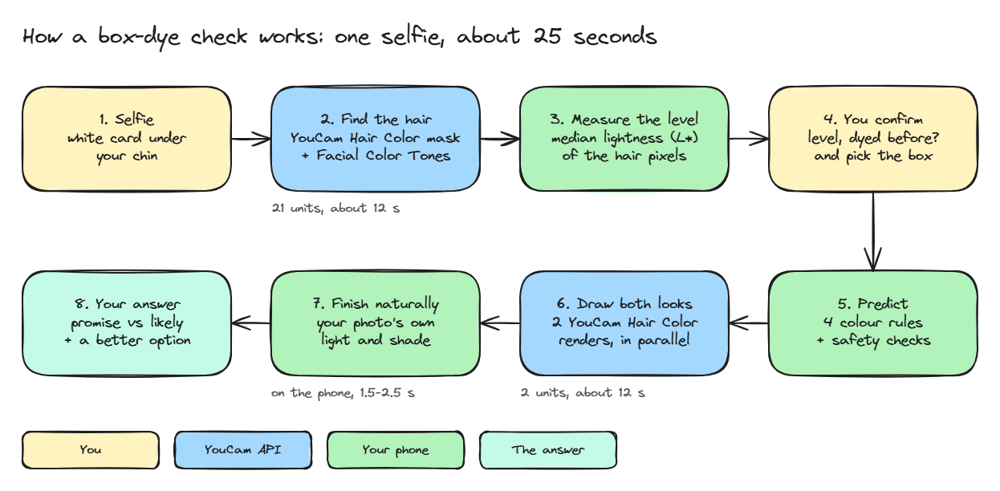

1. Take a selfie with a white card or sheet of paper under your chin.
2. YouCam finds every hair pixel; your phone measures how light that hair is and turns it into a level from 1 (black) to 10 (lightest blonde).
3. You confirm the level (or nudge it by one), say whether you've dyed before, and pick the box you were going to buy.
4. You answer three safety questions taken from the dye label.
5. You see two pictures of your own hair side by side, **what the box promises** and **what you'll probably get**, with one sentence that states the gap, for example:
   > "Predicted level 6 orange blonde versus promised level 9 ash: 3 levels short."
6. You see what will work instead: box shades the same rules expect to land on your hair.

**2. Hair profile** (optional, about a minute)

Four guided photos (front, left side, right side, head tilted down). A live head-angle guide speaks, vibrates and takes each photo for you once you're in position. YouCam measures hair type, frizz, length and density, and Bense gives general care tips for coloured hair. The profile adds context; it never changes the colour prediction or the safety checks.

**The three classic box-dye surprises Bense catches**

| Person | Their hair | The box | What Bense shows |
|---|---|---|---|
| A, "the brass surprise" | Natural medium brown, level 4 | Very light ash blonde 9 | Orange-brass around level 6: 3 levels short (with a 2-level lift) |
| B, "dye can't lift dye" | Box-dyed black | Light brown | Almost no change: new dye can't lighten old dye |
| C, "the green surprise" | Lightened before, yellow, level 8 | Ash 8 | Reaches the level, but with a green-tone risk |

**Demo mode** shows all three, plus a hair-profile example, with no photo and no API key. Every result in the app is labelled *Live YouCam*, *Calculated by rules* or *Demo example*, so nobody mistakes an example for their own result.

---

## 3. How the prediction works

The prediction is **four fixed rules from the dye makers' and colourists' own guidance**, not an AI guess. There is no language model anywhere in the result. Each rule links to its source inside the app.

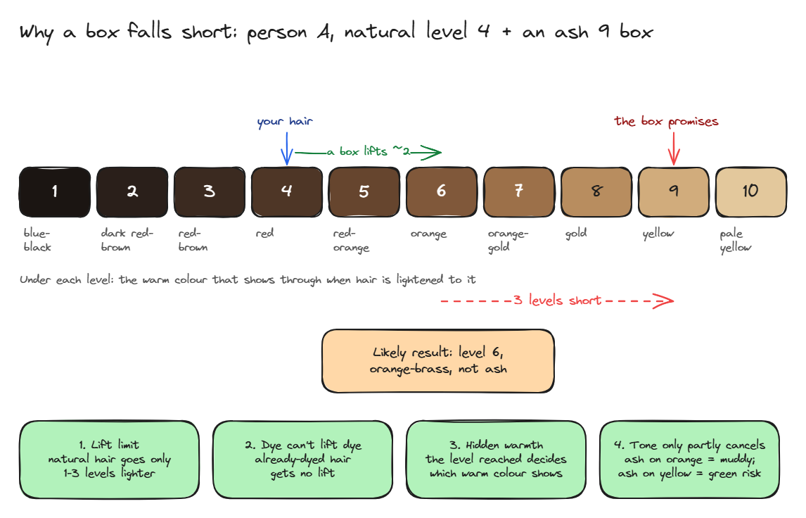

| Rule | In plain words | Source |
|---|---|---|
| 1. Lift limit | Natural hair goes only 1–3 levels lighter with a box. The app assumes **1** by default so it never over-promises; Settings allows 2 or 3. | [Garnier USA](https://www.garnierusa.com/en/hair-color-needs/new-to-hair-color) |
| 2. Dye can't lift dye | Already-dyed hair gets no lift: you get your current colour plus a bit of the new tone. | [The Shade](https://the-shade.helpscoutdocs.com/article/52-how-light-can-i-colour-my-hair) |
| 3. Hidden warmth | Lightening exposes warm colour in a fixed order: red-brown, red, red-orange, orange, gold, yellow, pale yellow. The level you reach decides which shows. | [Open Exam Prep](https://open-exam-prep.com/study-guides/tx-barber/haircoloring/color-formulation-correction) |
| 4. Tone only partly cancels | Ash softens orange but can't remove it (a muddy warm result); ash on yellow or porous hair can turn green. | [CurlCentric](https://www.curlcentric.com/why-is-my-hair-turning-green-when-i-dye-it/) |
| Extra: semi- and demi-permanent | These deposit colour only, so they are predicted not to lighten at all. | [Wella](https://www.wella.com/professional/en-GB/blog/hair-colour/differences-between-semi-and-demi-permanent-hair-color) |

**Worked example (person A):** level 4 hair + an ash 9 box. With a 2-level lift the hair reaches level 6, where orange shows. Ash only partly cancels it. Result: orange-brass level 6, **3 levels short** of the box.

**Safety comes first.** The app asks three questions straight from the label. These answers stop the at-home result, whatever the colour maths says:

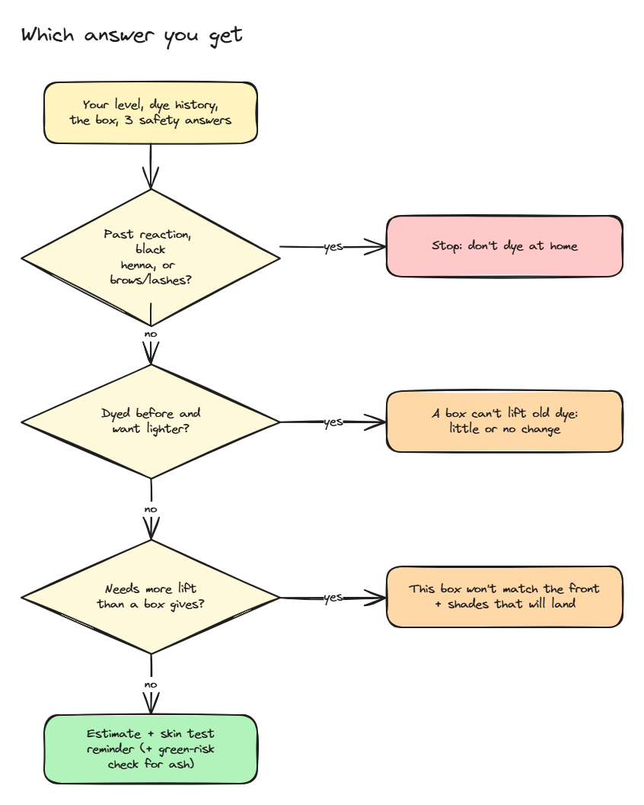

| If you say… | Bense says | Source |
|---|---|---|
| You've reacted to hair dye before | Don't use this box at home | [FDA](https://www.fda.gov/cosmetics/cosmetic-products/hair-dyes), [NHS](https://www.nhs.uk/conditions/hair-dye-reactions/) |
| You've had a "black henna" tattoo | Don't use this box at home | [FDA](https://www.fda.gov/cosmetics/cosmetic-products/hair-dyes) |
| You plan to dye brows or lashes | Don't: the FDA warns this "may cause blindness" | [FDA](https://www.fda.gov/cosmetics/cosmetic-products/hair-dyes) |
| (Always) | Do the skin allergy test in the box instructions, every time | [FDA](https://www.fda.gov/cosmetics/cosmetic-products/hair-dyes) |

The result is always labelled an **estimate**, never a guarantee.

---

## 4. Measuring your hair level

YouCam's colour reading (Facial Color Tones) returns a colour *name*, one of seven fixed swatches, not a measurement. In our live test it was usable on only **4 of 7** photos. So Bense measures the level itself, from the hair pixels.

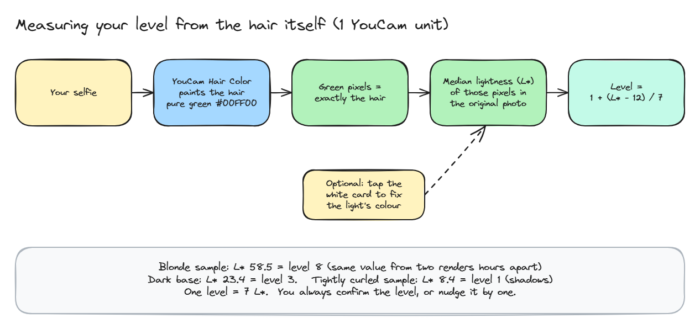

**The trick:** YouCam Hair Color is built to recolour hair, so we ask it to paint the hair pure green (`#00FF00`). The green pixels are exactly the hair. The phone takes the **median lightness (CIE L\*)** of those pixels in the original photo and maps it to a level: one level is 7 L\*. If you tap the white card in your selfie, the phone first corrects the light's colour against it.

| Measured live | Result |
|---|---|
| Blonde sample | L\* 58.5 = level 8, and 58.58 from a second render hours later |
| Synthetic dark-brown base | L\* 23.4 = level 3 |
| Tightly curled sample | L\* 8.4 = level 1 (shadows between curls pull it darker) |
| Working size 256 to 1024 px, 0–3 px of edge trimming | Moves the result by under 0.6 L\* |
| Reading + mask + measurement, in the browser | 12.3 s, in parallel |

The lightness-to-level bands are not yet calibrated against salon-graded photos, so the app always shows the level as a suggestion you confirm.

---

## 5. Making the dye look like real hair

YouCam's Hair Color render gets the colour right, but it flattens the photo's own light and shade: the gloss bands, the darker underlayer and the strand contrast become one even tone, like paint. We tried YouCam's own `shine_intensity` at 0, 50 and 80: no visible change. So Bense finishes the render on the phone.

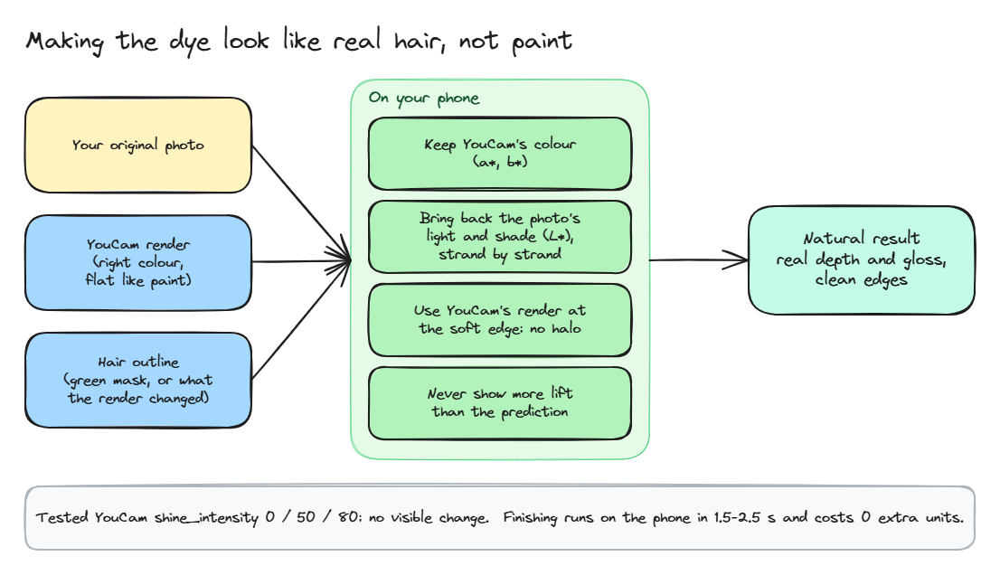

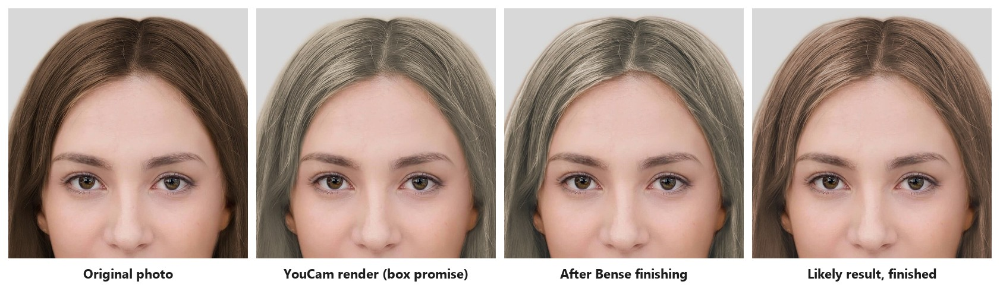

*YouCam's documentation sample photo, recoloured to dark brown as a test base. Left to right: the original, YouCam's raw box-promise render, the same render after Bense finishing, and the likely result after finishing.*

What the finishing does, in order:

1. **Keeps YouCam's colour** (the a\*/b\* hue and strength of every hair pixel).
2. **Brings back the photo's own light and shade** (L\*), strand by strand. Lighter hair shows more contrast than dark hair, so the contrast is scaled to match, and it never goes past the hair's own brightest and darkest values.
3. **Cleans the edge:** at the soft hair edge it uses YouCam's own render, so there is no pale halo.
4. **Never shows more lightening than the prediction allows.** For box-dyed black hair, "almost no change" now really looks like no change.

| Number | Value |
|---|---|
| Extra YouCam units | **0** (it reuses the hair mask from the level measurement) |
| Time on the phone | about **1.5–2.5 s**, in a Web Worker so the screen stays smooth |
| Match between the app's TypeScript and our Python prototype | mean difference **under 0.3 out of 255** per pixel |

---

## 6. The YouCam APIs we use

Six YouCam AI APIs, eight calls in a full session, about **30 units**. With the **1,000 free units** every registrant gets, that's about 33 full sessions.

| API | Task endpoint (`/s2s/v2.0/task/…`) | What it does in Bense | Photo | Units | Time | Live-verified |
|---|---|---|---|---|---|---|
| Hair Color, green mask | `hair-color` | Marks the hair pixels for the level measurement | Selfie | 1 | with the reading | Yes |
| Facial Color Tones | `skin-tone-analysis` | Colour family as a cross-check, plus face and lighting quality | Selfie | 20 | 9.5 s | Yes |
| Hair Color, box promise | `hair-color` | The box shade on your own hair | Selfie | 1 | 12.1 s for both | Yes |
| Hair Color, probable result | `hair-color` | The predicted colour on your own hair | Selfie | 1 | (same) | Yes |
| Hair Type Detection | `hair-type-detection` | Curl pattern as a range (1 straight to 4C coily) | Front + both 45° sides | 2 | 20–28 s for all four | **Not yet** |
| Hair Frizziness Detection | `hair-frizziness-detection` | Four frizz levels | Same three photos | 2 | (same) | **Not yet** |
| Hair Length Detection | `hair-length-detection` | Eight length bands | Front | 2 | about 9 s alone | Yes |
| Hair Density Detection | `hair-density-detection` | Four density levels | Head tilted down | 1 | (same) | Yes |

**Totals:** colour check **23 units** (20 + 1 + 2); hair profile up to **7**. Failed tasks cost nothing.

Every task is asynchronous: the server uploads the photo with the File API, starts the task, polls until it finishes, and downloads the result straight away (result links last 2 hours).

---

## 7. Where each part runs

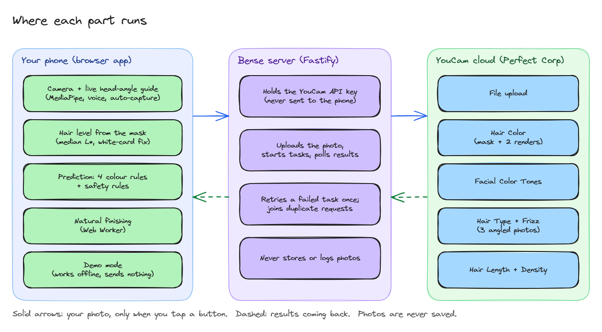

| Part | What it is |
|---|---|
| **Phone app** | A web app you open in the browser and can install to the home screen (PWA). React 19, Vite, TypeScript. |
| **On the phone** | Camera with a live head-angle guide (MediaPipe Face Landmarker: speech, vibration, auto-capture after a 1.5 s hold), the level measurement, the rules engine, the natural finishing, demo mode. |
| **Bense server** | Fastify 5 + Zod. It is the only place the YouCam key lives. It runs tasks, retries a failed task once, and joins duplicate requests so you never pay twice. |
| **YouCam cloud** | Perfect Corp's APIs, listed above. |

**Privacy, in plain words**

- Photos leave your phone only when you tap a button that says so.
- The server forwards them to YouCam and never saves or logs them.
- The browser keeps photos in memory only, gone when you close the tab. Choices (level, shade) sit in the browser's session storage.
- The API key is never sent to the phone.
- Demo mode sends nothing at all.

---

## 8. What we tested live, and what we found

Live tests on real photos (October 15–17, 2026). These changed the design.

| What we tested | What happened | What we changed |
|---|---|---|
| Facial Color Tones on 7 free-licence portraits (brown, black, blonde, red, two curly, a short-haired man) | **4 of 7 usable.** Black hair read as "Auburn", red hair as "Grey/White", the short-haired man as "no hair". A clearly blonde docs sample also read as "Auburn". | The level now comes from our own hair-pixel measurement; the colour name is only a cross-check. |
| Hair Color, darkening | Blonde went from L\* 55 to 21. Works strongly. | — |
| Hair Color, lightening | Brown at L\* 21 reached only 43 with a level-9 target (36 at strength 80). On dark hair the "promise" picture reaches about level 5–6. | The numbers and the headline carry the level gap; the pictures carry the tone. Both renders run at full strength. |
| Ash shades | Low-colour ash rendered as grey or silver. | Raised the ash colour in the shade model. |
| `shine_intensity` 0 / 50 / 80 | No visible difference: renders stay flat. | Built the natural finishing (section 5). |
| Black hair, "almost no change" result | The raw render still lightened black to brown. | The finishing caps the picture at the predicted lift. |
| Hair Length on slightly turned faces | 3 of 3 rejected (`error_face_angle_invalid`). Front must be within 10°, sides turned more than 15°. | Built the live head-angle guide with auto-capture. |
| Hair Length / Density | Length: "long hair", "above chest or longer". Density: "Low Density" (score 0.92–0.94), matching the docs' own label. | — |
| Hair Type / Frizz | The docs' only three-view sample uses 90° profiles, which YouCam rejects. | **Not verified yet**; needs real 45° photos. |
| Occasional `unknown_internal_error` | Density failed twice, then worked; Length failed when sharing an upload. | Retry once automatically; each task group gets its own upload. |
| Timing, end to end in the browser | Reading 12.3 s, two renders 12.1 s, whole mobile flow 27.9 s. | Calls run in parallel. |
| A big dye brand's own online try-on, on our own natural black hair (level 1–2) | It never asked for the current colour or dye history, and showed reddish blonde and bright ruby on black hair, with no warning and no level gap. | Confirms the gap Bense fills. |

---

## 9. The research that led here

We read every one of the 238 entries in edition 1 and every edition 2 build we could find before choosing this idea.

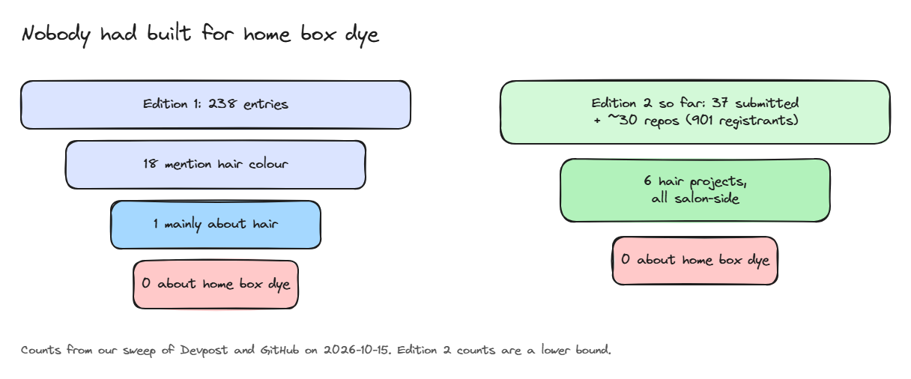

- **Edition 1:** 238 entries. Seven look-alike categories (colour seasons, AI stylists, selfie-to-routine and four more) held **53%** of the field and **won nothing**. All five winners came from **30 entries** in four thin categories, and each one answered a question a person can't answer by looking.
- **Hair was almost empty:** 1 entry was mainly about hair, 18 mentioned hair colour in passing, **0** were about dyeing at home.
- **Edition 2 so far** (October 15): 37 submitted projects plus about 30 GitHub repos, out of 901 registrants. 6 hair projects, all salon-side. **None** about home box dye.
- **How winners wrote:** they stated a problem in retail terms, measured instead of guessed, labelled demo data honestly, and gave judges a "check it yourself" table. Bense follows the same pattern.
- **The idea scored 51/70** on our own gates (real sufferers, reach, needs YouCam, novelty, demoable on a phone), ahead of the runner-up ideas.

**Who would pay for it**

| Buyer | Why |
|---|---|
| Multi-brand beauty shops | When a box won't work, the cart swaps to one that will, so the shop keeps the sale and avoids a complaint. |
| Perfect Corp | A "realistic result" option for its own Hair Color API: the same call plus Bense's rules and finishing. Its own blonde filter admits it "may not fully reflect" porosity or pigment absorption ([Perfect Corp](https://www.perfectcorp.com/business/products/blonde-hair-filter)). |
| Challenger dye brands | A "which of our boxes will actually work for you" step. |

The full research, with every number graded by how strong its source is, is in [`docs/submission/`](docs/submission/): [problem numbers](docs/submission/research/problem-numbers.md), [who else is working on this](docs/submission/research/landscape.md), [how winning entries were written](docs/submission/research/winner-patterns.md) and [the evidence table](docs/submission/EVIDENCE.md).

---

## 10. Research articles: what they say, and how YouCam and Bense answer them

Each article below shaped a rule, a warning or a screen in Bense. **YouCam's part** is what the YouCam APIs contribute; where no YouCam API can address the article, the table says so. **Bense's answer** is what we built on top.

### People want to dye at home, and worry about the result

| Article | What it says (relevant part) | YouCam's part | Bense's answer |
|---|---|---|---|
| [CEW / Clairol, Apr 2024](https://cew.org/?p=42538) | **80%** of 2,000 US women colour their hair. | Hair Color API puts any shade on a selfie, at mass-market scale. | Uses that same render, but for the result your hair will really get. |
| [BeautyMatter](https://www.beautymatter.com/articles/just-the-numbers-new-quarantine-hair-color-habits) | **33%** dyed at home during the pandemic; **88%** of them to cover greys. | Not covered by an API. | Built for the home-dye moment: one selfie, about 25 seconds, before you buy. |
| [Mintel, India 2024](https://www.mintel.com/insights/beauty-and-personal-care/latest-hair-colour-trends-in-india) | Over half of Indian users colour to cover greys, at home first; **4 in 10** former users say it left hair very dry. | Hair Type, Frizz, Length and Density read the hair from photos. | The hair profile turns those readings into care tips; the catalogue includes **53** real Indian shelf shades. |
| [Premium Beauty News (Garnier / OnePoll), Jan 2021](https://www.premiumbeautynews.com/en/at-home-hair-dyeing-a-first-for,17831) | **47.8%** of US women dyeing at home worried the result wouldn't be what they wanted; **42.7%** worried about picking the shade. | Hair Color renders the box shade on your own photo. | Shows two pictures side by side, the box's promise and the predicted result, with the level gap in numbers. |
| [The Drum (L'Oréal), May 2019](https://www.thedrum.com/news/2019/05/09/l-oreal-launches-direct-consumer-hair-dye-brand-colorco) | L'Oréal's own GM: up to **70%** of at-home colour users are unsure which shade suits them. | Not covered by an API. | When a box won't reach its shade, Bense suggests the closest real boxes that will, each with its own prediction. |

### What a box dye can and can't do

| Article | What it says (relevant part) | YouCam's part | Bense's answer |
|---|---|---|---|
| [Garnier USA](https://www.garnierusa.com/en/hair-color-needs/new-to-hair-color) | Permanent box dye lifts natural hair only **2–3 levels**; "another box of hair dye will not lighten your hair without bleach". | Hair Color returns a hair mask, so Bense measures lightness on hair pixels only. Facial Color Tones names the colour family as a cross-check. | Measures your starting level, caps the prediction at start + lift (a setting, default 2 levels), and shows how many levels short the box falls. |
| [The Shade](https://the-shade.helpscoutdocs.com/article/52-how-light-can-i-colour-my-hair) | Dye can't lift dye: a new box won't lighten hair that was coloured before. | A photo can't show dye history, so no API can tell. | Asks "Has your hair been dyed?" If yes, the predicted level stays where it is. |
| [Revlon Professional](https://cdn.revlonprofessional.com/blog/correct-black-box-dyed-hair) | Black box dye is the hardest to correct; dyed hair "can take twice as long to lighten each shade level". | In our tests the raw Hair Color render still lightened black hair to brown. | Warns on black or very dark dye, and the on-device finishing caps the picture at the predicted lift, so it never shows more change than the rules allow. |
| [Open Exam Prep (colour theory)](https://open-exam-prep.com/study-guides/tx-barber/haircoloring/color-formulation-correction) | Lightening exposes warm underlying pigment in order: red → orange → gold → yellow. | Hair Color renders tone well when given the right target colour. | Predicts which warm pigment will show at your result level and shifts the rendered colour warmer to match. |
| [CurlCentric, green tones](https://www.curlcentric.com/why-is-my-hair-turning-green-when-i-dye-it/) | Ash over yellow, lightened or porous hair can turn green. | In our tests YouCam rendered low-colour ash as grey or silver. | Raised the ash colour in the shade model, and warns to strand-test an ash shade over warm hair. |
| [CurlCentric, box dye](https://www.curlcentric.com/why-do-hairdressers-hate-box-dye/) | Henna and some box dyes react with other colour products. | A photo can't show what the earlier colour was. | Asks what the earlier colour was. For henna it warns of the reaction and asks for a strand test first. |
| [Wella](https://www.wella.com/professional/en-GB/blog/hair-colour/differences-between-semi-and-demi-permanent-hair-color) | Semi- and demi-permanent colour adds tone but doesn't lighten. | Not covered by an API. | Reads each box's permanence from the catalogue; semi and demi boxes predict no lift. |

### Safety

| Article | What it says (relevant part) | YouCam's part | Bense's answer |
|---|---|---|---|
| [NHS, hair dye reactions](https://www.nhs.uk/conditions/hair-dye-reactions/) | Reactions are "fairly common but are usually mild"; symptoms "can take up to 72 hours to appear"; avoid PPD dyes after a reaction, and "black henna" can contain high PPD. | Not a job for an image API. | Three safety questions come before any result. A past reaction or black henna stops the at-home suggestion; every result reminds you to do the box's skin test. |
| [FDA, hair dyes](https://www.fda.gov/cosmetics/cosmetic-products/hair-dyes) | Hair dyes can cause allergic reactions and hair loss, and eye injuries including blindness near the eyes; no colour additive is approved for brows or lashes. | Not a job for an image API. | Asks if you plan to dye brows or lashes, and if so says don't. |
| [PubMed, India study](https://pubmed.ncbi.nlm.nih.gov/24574693/) | **42%** of hair-dye users reported adverse reactions; **34%** had never done a skin test. | Not a job for an image API. | The skin-test reminder appears on every result, not only when something looks risky. |

### What a wrong box costs, and the gap in today's try-ons

| Article | What it says (relevant part) | YouCam's part | Bense's answer |
|---|---|---|---|
| [Bluffton Hair Lounge](https://blufftonhairloungecom-s2lwc-commit-0b4812d.kinsta.page/services/color-correction/), [BangStyle](https://www.bangstyle.com/posts/Box-Dye-Hair-Color-What-You-Need-To-Know-821), [SalonGeek](https://salongeek.com/threads/colour-correction.125144) | Colour correction costs **$200–800** and can take up to **4** visits. | Hair Color shows a look before anything is bought. | Catches the mismatch before you buy, and offers a closer box that can actually reach its shade. |
| [Perfect Corp, blonde hair filter](https://www.perfectcorp.com/business/products/blonde-hair-filter) | Perfect Corp's own blonde try-on says it "may not fully reflect" porosity or pigment absorption. | The same Hair Color API call Bense builds on. | Adds what that note says is missing: your starting level, dye history, the lift limit and natural finishing. That's the "realistic result" layer. |

---

## 11. The shade catalogue

**245 shades** in two sets:

| Set | Count | Notes |
|---|---|---|
| Example shades | **43** | Made up for the demo, not real products. Used in the video, so no trademarks appear. |
| Real shelf shades, USA | **149** | L'Oréal Paris 94, Garnier 55 |
| Real shelf shades, India | **53** | L'Oréal Paris 34, Garnier 19 |

- Real shades were read from the brands' own websites on October 16, 2026.
- The level is the first number of the shade code (the usual convention). Garnier USA is the only brand that publishes its code guide.
- Swatch colours are our model, not the brand's colour.
- Shades with no whole level, and lightening or bleach kits, are left out.
- L'Oréal Paris and Garnier are trademarks of their owners. Bense isn't affiliated with them.

---

## 12. Run it

You need Node 22+ and npm. The browser tests use an installed Edge or Chrome.

```sh
git clone https://github.com/Maheswar-Sah00/bense.git
cd bense
npm install
cp .env.example .env     # then set YOUCAM_API_KEY
npm run dev              # web on http://localhost:5173, API on http://localhost:8787
```

Open http://localhost:5173. Without a key, live calls say "not set up" and demo mode still works.

**Demo for judges (about 3 minutes, no photo or key needed)**

1. On the home screen, tap **Demo mode**, then **Start the walkthrough** (scenario A, "The brass surprise").
2. Starting colour: natural level 4. Tap + or − to see the same rules re-run.
3. Box shade: 9.1 Very light ash blonde.
4. Promise vs prediction: two real YouCam Hair Color renders of a sample photo, finished on the device and labelled as a demo example.
5. The gap: "Predicted level 6 orange blonde versus promised level 9 ash: 3 levels short."
6. Better option: the closest box shades the same rules expect to work.
7. **Next** to scenario B (dye can't lift dye) and C (green-tone risk), then the hair-profile example.

**On an Android phone, over a USB cable** (the camera works because the phone treats it as `localhost`):

1. On the phone: Settings → About phone → tap **Build number** 7 times, then turn on **USB debugging** in Developer options.
2. Plug in and tap **Allow** on the phone.
3. On the PC: `adb reverse tcp:5173 tcp:5173`
4. On the phone, open `localhost:5173` in Chrome.

**On any phone, over the internet:** `ngrok http 5173`, then open the `https://…ngrok…` link. Keep the link private: anyone with it can spend your units.

| Setting (`.env`) | Needed | Default |
|---|---|---|
| `YOUCAM_API_KEY` | For live features | none |
| `YOUCAM_API_BASE` | No | `https://yce-api-01.makeupar.com` |
| `PORT` | No | `8787` |

The key is read only by the server. Never prefix it with `VITE_`. `.env` files are git-ignored.

---

## 13. Tests

| Command | What it checks | YouCam units |
|---|---|---|
| `npm test` | **176** unit and server tests: the rules, safety, measurement, finishing, API handling | 0 (mocked) |
| `npm run test:e2e` | **34** browser tests at phone width (393 px): camera, capture, reading, shades, result, demo, offline, layout | 0 (mocked) |
| `npm run test:pwa` | Builds, then checks installability, the service worker and offline mode | 0 |
| `npm run typecheck` · `npm run lint` | TypeScript and ESLint | 0 |
| `npm run smoke:tones -- <photo>` | **Live** Facial Color Tones | 20 |
| `npm run smoke:level -- <photo>` | **Live** hair level measurement | 1 per photo |
| `npm run smoke:reveal -- <photo> --start 4 --shade <id>` | **Live** two Hair Color renders | 2 |
| `npm run smoke:hair -- --front f.jpg --left l.jpg --right r.jpg --top t.jpg` | **Live** hair analysis | up to 7 |
| `npm run smoke:walkthrough -- --selfie s.jpg` | **Live** both journeys through the real UI, with screenshots | about 30 |

A test also checks that demo data can never leak into a live result.

---

## 14. Honest limits

- The four colour rules come from brand and colourist guidance. They are **not scientifically validated**, so every result is an estimate.
- The lightness-to-level bands are **not calibrated** against salon-graded photos. Without the white card, light can shift the level by about one. You always confirm it.
- Very dark or tightly curled hair reads darker because of shadows between strands.
- YouCam Hair Color can't fully lighten dark hair in a picture, so the level numbers, not the image, carry the size of the gap.
- **Hair Type and Frizz are not verified live** yet.
- A photo can't measure porosity, strand thickness, scalp health or damage, and Bense never claims to. Nothing here is medical advice.
- The demo's dark-hair photo is synthetic (YouCam's documentation sample, recoloured). Scenarios B and C show colour swatches, not photos.
- No accounts, no database: this is a hackathon build, not a production service.

---

## 15. What's next

1. **Calibrate the level** with 10–20 selfies whose levels are graded by hand.
2. **Verify Hair Type and Frizz** with real photos turned about 45°.
3. **Show the better shade on your own hair** with a third Hair Color render.
4. **A matching brow pencil** through YouCam Makeup VTO (never brow dye).
5. **A "will this box work on me?" button for beauty shops**, with the cart swap.
6. **A `check_box_dye` tool for AI shopping agents**, so any assistant can ask before recommending a dye.

---

## 16. The logo

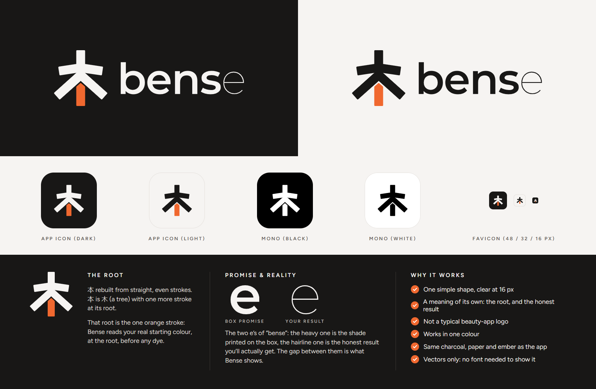

**What it is.** The mark is the character 本, the first half of 本色 ("your own true colour"), rebuilt from straight strokes that are all the same width. 本 is 木, a tree, with one more stroke that marks its root. In our mark the root is the one stroke in ember orange. Next to it, the word **bense** is set in lowercase.

**Why we chose it**

- **The root is the product.** Whether a box dye works depends on the hair you start with: your real colour, at the root. Bense reads that first, and the orange root says so in one stroke.
- **Promise and reality are in the name.** "bense" has two e's. The first is heavy: the bold shade printed on the box. The last is a hairline: the honest result you'll actually get. The gap between them is the gap Bense shows you.
- **It isn't another beauty logo.** No hair swooshes, droplets, faces or script fonts. And no paint brush, because "dye is not paint" is the whole point of the app.
- **It's built like the tools we admire.** Like Cursor, Linear or Vercel: one simple shape, one colour plus one accent, and still clear as a 16 px browser icon.
- **It speaks the app's language.** The same charcoal, paper and ember as the app's dark theme, so the icon, the home screen and this page feel like one product.

**How we picked it.** We looked at three directions:

| Direction | What it showed | Verdict |
|---|---|---|
| **本 with an orange root** | The name, plus "we measure your real hair first" | **Chosen.** A meaning no other app can claim, and clear at any size |
| A 1–10 level stripe with your level lit up | The hair level scale | Clear, but looks like a data tool, not a brand |
| Two overlapping swatches, one solid, one see-through | "Dye is see-through, not paint" | True, but close to many colour apps already |

**How it's built**

| Part | Detail |
|---|---|
| Strokes | All one width. The mark is 6 strokes wide and about 6.3 tall |
| Crossbar | Two arms that rise 8.6° toward the stem, like a shallow roof |
| Legs | 42° below horizontal, with square-cut ends |
| Root | As wide as the stem, with a pointed top that runs parallel to the legs and a small gap below them |
| Wordmark | Montserrat SemiBold for "bens" and Montserrat Thin for the last "e" ([SIL Open Font License](https://openfontlicense.org)), turned into outlines so no font has to load |

**Colours**

| Name | Hex | Used for |
|---|---|---|
| Charcoal | `#181716` | Dark backgrounds; the strokes on light backgrounds |
| Paper | `#F6F4F2` | Light backgrounds; the strokes on dark backgrounds |
| Ember | `#F0682F` | The root, and only the root |

**Using it**

- On dark backgrounds: paper strokes, ember root. On light backgrounds: charcoal strokes, ember root.
- On a coloured background, or when printing in one colour: the mono version, with the root in the same colour as the rest.
- Leave at least one stroke width of empty space around the mark. Smallest sizes: 16 px for the mark, 80 px wide for the mark with the word.
- Don't stretch it, recolour the root, or add shadows, outlines or gradients.

**Where it lives**

| File | Used for |
|---|---|
| [`docs/brand/bense-logo-dark.svg`](docs/brand/bense-logo-dark.svg), [`-light.svg`](docs/brand/bense-logo-light.svg) | Mark with the word: the top of this README, slides, the video |
| [`docs/brand/bense-mark-*.svg`](docs/brand/) | The mark alone: dark, light, mono black, mono white |
| [`docs/brand/bense-icon-dark.svg`](docs/brand/bense-icon-dark.svg), [`-light.svg`](docs/brand/bense-icon-light.svg) | App icon tiles |
| [`public/icon.svg`](public/icon.svg) | Browser tab icon |
| `public/icon-192.png`, `icon-512.png`, `icon-maskable-512.png` | The installed app on Android. The maskable one keeps the mark inside the safe circle, so no launcher crops it |
| `public/apple-touch-icon.png` | iPhone home screen |
| [`src/components/Logo.tsx`](src/components/Logo.tsx) | Inside the app: home screen header, desktop sidebar, and the backs of the demo cards. It uses the text colour, so it follows light and dark themes |

---

## 17. Project map

```
bense/
├── README.md                 ← you are here
├── LICENSE                   ← MIT
├── src/                      ← phone app (React): screens, camera, head-angle guide, finishing worker, logo
├── server/                   ← Fastify server: YouCam client, routes, live smoke scripts
├── shared/
│   ├── domain/               ← rules engine, level measurement, natural finishing, care tips
│   ├── catalogue/            ← 43 example + 202 real shades
│   └── demo/                 ← demo scenarios A, B, C and recorded results
├── e2e/                      ← browser tests and live walkthrough scripts
├── public/                   ← icons, demo images, MediaPipe model
└── docs/
    ├── brand/                ← the logo: SVGs for every use, and the brand sheet
    ├── diagrams/             ← the diagrams above, as .png and editable .excalidraw
    ├── images/               ← screenshots and the before/after figure
    ├── submission/           ← Devpost text, video script, gallery plan, evidence and research
    └── youcam-api/           ← official YouCam API contracts + our live-test notes
```

The diagrams are real Excalidraw files: open any `docs/diagrams/*.excalidraw` at [excalidraw.com](https://excalidraw.com) to edit it.

---

## 18. Sources

**Dye rules and safety:** [Garnier USA](https://www.garnierusa.com/en/hair-color-needs/new-to-hair-color) · [The Shade](https://the-shade.helpscoutdocs.com/article/52-how-light-can-i-colour-my-hair) · [Open Exam Prep](https://open-exam-prep.com/study-guides/tx-barber/haircoloring/color-formulation-correction) · [CurlCentric, green tones](https://www.curlcentric.com/why-is-my-hair-turning-green-when-i-dye-it/) · [CurlCentric, box dye](https://www.curlcentric.com/why-do-hairdressers-hate-box-dye/) · [Revlon Professional](https://cdn.revlonprofessional.com/blog/correct-black-box-dyed-hair) · [Wella](https://www.wella.com/professional/en-GB/blog/hair-colour/differences-between-semi-and-demi-permanent-hair-color) · [FDA, hair dyes](https://www.fda.gov/cosmetics/cosmetic-products/hair-dyes) · [NHS, hair dye reactions](https://www.nhs.uk/conditions/hair-dye-reactions/)

**Market and cost:** [CEW](https://cew.org/?p=42538) · [BeautyMatter](https://www.beautymatter.com/articles/just-the-numbers-new-quarantine-hair-color-habits) · [Cosmetics Business](https://www.cosmeticsbusiness.com/scott-cornwall-survey-reveals-uk-hair-colouring-facts-93101) · [Mintel](https://www.mintel.com/insights/beauty-and-personal-care/latest-hair-colour-trends-in-india) · [Bluffton Hair Lounge](https://blufftonhairloungecom-s2lwc-commit-0b4812d.kinsta.page/services/color-correction/) · [BangStyle](https://www.bangstyle.com/posts/Box-Dye-Hair-Color-What-You-Need-To-Know-821) · [SalonGeek](https://salongeek.com/threads/colour-correction.125144) · [Perfect Corp blonde filter](https://www.perfectcorp.com/business/products/blonde-hair-filter) · [Premium Beauty News](https://www.premiumbeautynews.com/en/at-home-hair-dyeing-a-first-for,17831) · [The Drum](https://www.thedrum.com/news/2019/05/09/l-oreal-launches-direct-consumer-hair-dye-brand-colorco) · [PubMed, India dye reactions](https://pubmed.ncbi.nlm.nih.gov/24574693/)

**Hackathon:** [Edition 1 gallery](https://youcam-api.devpost.com/project-gallery) · [Edition 2 overview](https://youcam-api-skin-ai-ecommerce.devpost.com/) · [Edition 2 rules](https://youcam-api-skin-ai-ecommerce.devpost.com/rules) · [Edition 2 gallery](https://youcam-api-skin-ai-ecommerce.devpost.com/project-gallery)

**YouCam APIs:** [YouCam API docs](https://docs.perfectcorp.com/) · the contracts we build against are saved in [`docs/youcam-api/`](docs/youcam-api/).

*Photos used only for local testing (from Wikimedia Commons) are not included in this repository. The demo images use YouCam's own documentation sample photo.*

---

Released under the [MIT licence](LICENSE). L'Oréal Paris and Garnier are trademarks of their owners; Bense isn't affiliated with them.
